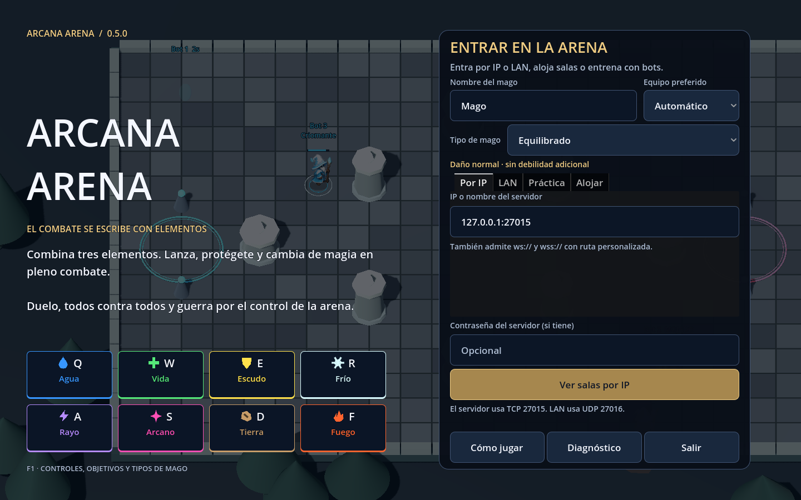
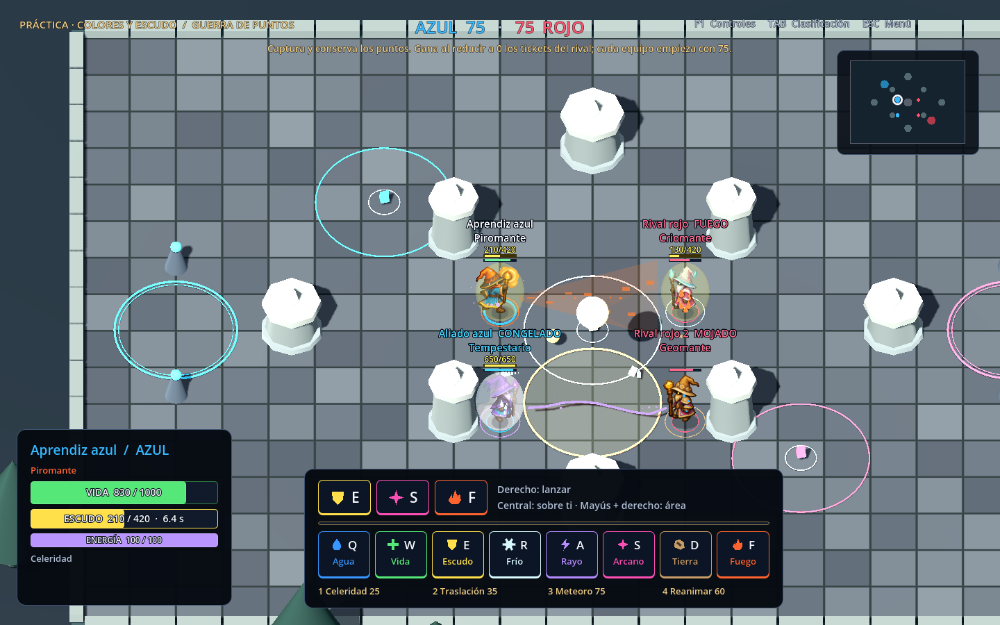
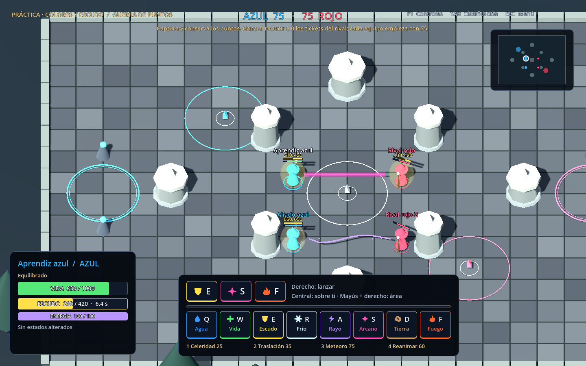
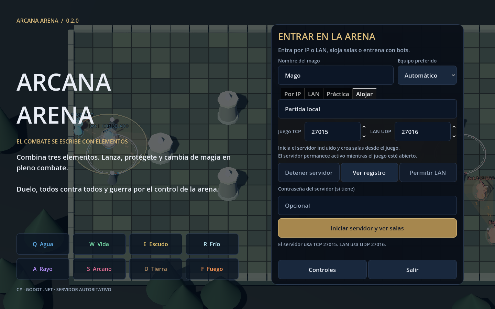
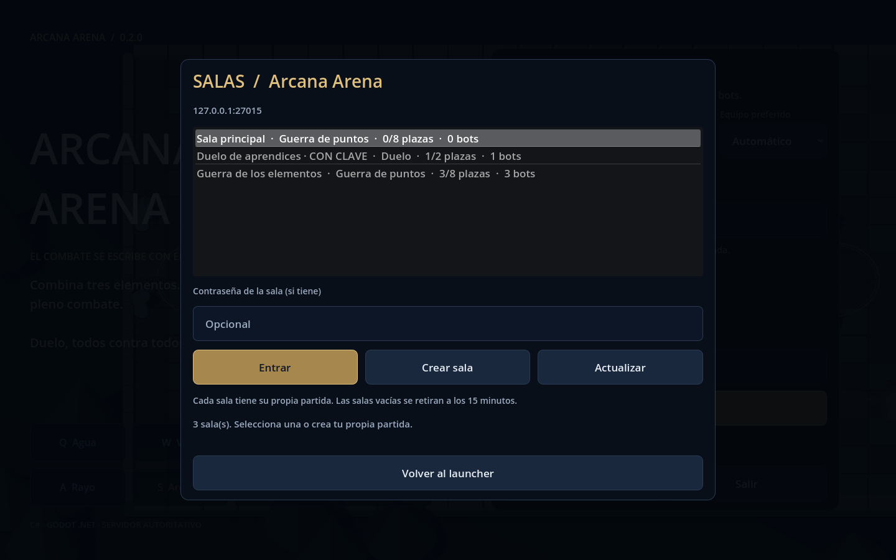
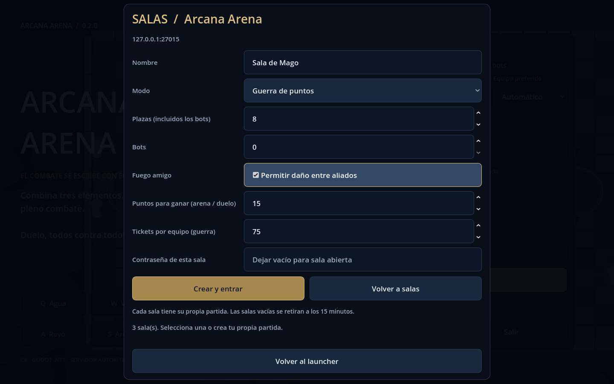

# Arcana Arena — v0.8.0

Primera recreación jugable en C# del combate elemental de **Magicka: Wizard Wars**. Cliente 3D de escritorio con **Godot 4.5.2 .NET**, servidor independiente **ASP.NET Core / .NET 8**, Docker, launcher con conexión por IP/LAN, salas independientes y paquete Windows para abrir con doble clic.

El código, las mallas y los sonidos son propios. Los sprites de los magos se han generado para este proyecto. Esta versión reproduce la estructura del combate; los gráficos, mapas, magicks y valores de daño son una aproximación, no una reproducción exacta del original.








## Qué se puede jugar

- Ocho elementos y hasta tres elementos por hechizo. Las combinaciones se resuelven por reglas, no por un catálogo de unos pocos hechizos.
- Rayos continuos, chorros en cono, arcos eléctricos, rocas con carga, fragmentos de hielo, vapor, muros, minas y lanzamientos en área.
- Curación, escudos, guardas elementales, empujes, mojado, quemaduras, frío y congelación. Fuego amigo configurable.
- Colores con más contraste y símbolos por elemento. Vida y escudo separados: el escudo muestra puntos/capacidad real y segundos restantes; también aparece sobre el mago.
- Duelo, todos contra todos y guerra por tres puntos de control, con tickets, muerte, reaparición y reinicio de partidas. El objetivo y el límite real aparecen en la sala y en el HUD; ayuda **F1 → Cómo ganar**.
- Cinco tipos de mago: equilibrado, piromante, criomante, tempestario y geomante. Bonus elemental del 25 % y debilidad del 25 %, elegidos antes de entrar y calculados por el servidor.
- Sprites propios para los cinco magos, con cuatro orientaciones, pasos y poses de lanzamiento. Túnicas por equipo y detalles de especialidad; barras sobre el sombrero. [Arte y código de los sprites](docs/SPRITES-MAGOS.md).
- Estelas, ondas, impactos, fragmentos de hielo/roca, explosiones, destellos y rotura de escudo. Quemadura, mojado, frío y celeridad con partículas. Efectos con nodos reutilizados y límites fijos.
- Cuatro magicks: celeridad, traslación, meteoro y reanimación. Coste de energía y tiempos de reutilización.
- Splash selectivo en rocas imbuidas, suelo ardiente/helado/charcos, minas ofensivas y minas de vida que respetan equipos. Escudo de vida con regeneración gradual y cese al romperse.
- Rayos que se unen en el cruce y suman componentes; reflexión en escudos y refracción con guardas elementales, con dos rebotes como máximo.
- **F1 → Combinaciones:** 120 combinaciones, tres formas de lanzamiento, demostraciones animadas en bucle, pausa/repetición y escenas de cruce, escudo y captura.
- Puntos de control con círculo que se rellena por equipo, porcentaje y estado disputado.
- Tres mapas seleccionables: Arena clásica, Ciudadela de los pasillos (4× de suelo y victoria por control total) y Coliseo de la ascensión. Solo en Ascensión, cada baja añade 10 de vida permanente y cada muerte añade 0,5 segundos de reaparición, hasta 10 segundos.
- Bots que combaten, se curan y capturan puntos. Práctica local sin iniciar Docker.
- Launcher: IP/dominio, búsqueda LAN, servidor incluido, configuración gráfica y creación de salas con modo, bots, aforo y contraseñas.
- Distribución Windows x64 autónoma: motor, cliente, servidor y runtimes incluidos. No necesita instalar Godot, .NET ni Docker para jugar o alojar.
- Servidor autoritativo a 60 pasos/s, envío de estado a 20 Hz y representación interpolada en el cliente.

**Demostraciones en vídeo:** [splash, regeneración y minas](docs/videos/combination-effects.mp4) · [cruce de rayos](docs/videos/beam-interactions.mp4) · [refracción en escudos](docs/videos/shield-refraction.mp4) · [captura por equipos](docs/videos/point-capture.mp4). Dentro del juego, **F1 → Combinaciones** muestra cada receta y sus tres modos de lanzamiento. [Reglas y valores](docs/COMBINACIONES.md).

## Jugar con doble clic en Windows

1. Descargar [ArcanaArena-v0.8.0-Windows-x64.zip](https://github.com/andresmartinezmelgar/magicka/releases/download/v0.8.0/ArcanaArena-v0.8.0-Windows-x64.zip) de [Releases](https://github.com/andresmartinezmelgar/magicka/releases/latest).
2. **Extraer todo el ZIP** en una carpeta. Abrir **ArcanaArena.exe** con doble clic.
3. Elegir el **tipo de mago**. Elegir **Práctica** para jugar con bots, **Alojar** para iniciar tu servidor, **LAN** para buscar servidores o **Por IP** para usar una dirección.

En **Práctica**, elegir el modo y el **Mapa** antes de empezar. En **Alojar**, elegir nombre del servidor, puertos y contraseña opcional. Pulsar **Iniciar servidor y ver salas**. Desde la pantalla de salas, pulsar **Crear sala**, elegir modo, **Mapa**, plazas, bots, fuego amigo y límites de victoria; finalmente, **Crear y entrar**. Otros jugadores abren el mismo ejecutable, buscan el servidor en **LAN** y eligen tu sala. La sala les envía el mapa elegido. También pueden usar la IP de tu equipo en **Por IP**.

El servidor se inicia sin consola y permanece activo durante tu partida. **Detener servidor** o cerrar el juego cierra las salas que estás alojando. El launcher recuerda nombre y puertos; las contraseñas se mantienen solo en memoria.

El botón **Permitir LAN** configura dos reglas específicas del servidor en redes privadas. Windows solicita permiso de administrador mediante UAC. Si cambias puertos o mueves la carpeta del juego, puedes volver a pulsarlo. El botón **Ver registros** abre la carpeta de logs. **Diagnóstico** exporta un ZIP con los registros del cliente, el servidor alojado y el contexto de la partida.

La distribución incluye todos los archivos necesarios. El `.exe`, el `.pck`, la carpeta de datos y `server/` se conservan juntos. No hace falta instalar el SDK .NET, Godot ni Docker en el PC de los jugadores. Requisitos: Windows 10/11 x64 y gráficos compatibles con OpenGL 3.3.







## Compilar con doble clic

Descargar el código con **Code → Download ZIP** y extraer todo, o actualizar el repositorio local. Abrir **`Compilar-Juego.cmd`** en la raíz. Instala el SDK .NET 8 x64 y Godot 4.5.2 .NET en `.tools/`, descarga sus plantillas y compila cliente y servidor. La primera ejecución necesita Internet; después reutiliza las herramientas.

El resultado queda en **`Juego/ArcanaArena.exe`**. Cada compilación correcta **sustituye completamente `Juego/`**, incluidos los archivos antiguos. Cerrar el juego antes de recompilar. Si la compilación falla, se conserva el resultado anterior. Registro: `artifacts/compilacion-*.log`. No requiere Visual Studio ni instalación de administrador. [Proceso y compilación manual](docs/EXPORTAR.md).

## Cómo ganar y tipos de mago

- **Duelo:** primer equipo que llega al límite de bajas; por defecto 15, o 5 en práctica.
- **Todos contra todos:** primer mago que llega al límite de bajas; por defecto 15.
- **Guerra en Arena clásica:** reducir a cero los tickets rivales; controlar más puntos los desgasta cada segundo y cada muerte cuesta un ticket.
- **Guerra en Ciudadela:** controlar los tres puntos sin disputa durante **15 segundos consecutivos**. Disputar o neutralizar cualquiera reinicia el contador; no hay victoria por tickets o bajas.

Los valores de la sala prevalecen sobre los valores por defecto. [Reglas completas](docs/COMO-GANAR.md) · [Bonus y debilidades de los cinco tipos](docs/TIPOS-DE-MAGO.md). El combate usa **protocolo 6**. Actualizar cliente y servidor juntos a v0.8.0; las versiones anteriores se rechazan en el saludo.

## Mapas

| Mapa | Superficie de suelo | Diseño | Guerra de puntos |
|---|---|---|---|
| Arena clásica | 1.408 unidades² | Arena original de 44×32. | Desgastar los tickets rivales. |
| Ciudadela de los pasillos | 5.632 unidades², exactamente 4× | Tres salas de 22×64 conectadas por dos pasillos de 22×32; contorno irregular dentro de 110×64. | Mantener los tres puntos durante 15 segundos consecutivos. |
| Coliseo de la ascensión | 2.688 unidades² | Suelo en cruz, zona central amplia y cuatro pilares simétricos. | Desgastar los tickets rivales; +10 de vida por baja y +0,5 s de reaparición por muerte. |

La cámara sigue al mago por el escenario grande. El minimapa representa el suelo y sus límites. Los patios sin suelo bloquean caminar, rayos, proyectiles y traslación. El desplazamiento al cursor y los bots buscan una ruta por los pasillos. Duelo y todos contra todos conservan sus condiciones de victoria en los tres mapas. En Ascensión se añaden las reglas de vida y reaparición.

En **Ascensión**, cada baja de otro mago suma 10 a tu vida máxima y a la actual si sigues vivo. Se conserva al morir y al ser reanimado; curaciones y minas respetan el máximo individual. Cada muerte aumenta 0,5 segundos la espera base del modo, hasta 10: la primera tarda 3 segundos en duelo y 4,5 en arena/guerra. La siguiente partida reinicia vida y penalización. [Reglas y tiempos](docs/COMO-GANAR.md#coliseo-de-la-ascensión).

## Diagnosticar un problema

Pulsa **Diagnóstico** en el launcher o **ESC → Exportar diagnóstico** durante una partida. Se genera un ZIP y se abre su carpeta. Incluye logs JSONL y `report.json` con versión, sesión, sala, jugador, tick, memoria y estado de conexión. Los errores conservan tipo, mensaje y traza; también se capturan avisos del motor Godot. No se copian la configuración del launcher ni variables de entorno. Las contraseñas conocidas se ocultan.

Cada componente (`client`, `host`, `server`) conserva hasta cinco archivos de aproximadamente 2 MiB, con nombres únicos por sesión. La escritura usa una cola acotada en segundo plano. Si el disco falla, la partida continúa y el informe indica el problema de escritura. Reiniciar el servidor conserva sus registros anteriores dentro de ese límite.

En Windows: `%APPDATA%\Godot\app_userdata\Arcana Arena\logs` y `reports`. Docker guarda los logs en `/app/logs`, en el volumen `server-logs` de Compose; sobreviven a recrear el contenedor. Para interpretar eventos y extraerlos: [diagnóstico](docs/DIAGNOSTICO.md).

## Abrir el código C#

Para **desarrollar**, instalar el SDK .NET 8 x64 y [Godot 4.5.2 .NET](https://github.com/godotengine/godot/releases/tag/4.5.2-stable). Abrir `ArcanaArena.sln` en Visual Studio, o ejecutar:

```powershell
dotnet build ArcanaArena.sln -c Debug
```

Importar `src/Arcana.Client/project.godot` en Godot y pulsar **F5**. [Exportar y empaquetar](docs/EXPORTAR.md) explica cómo regenerar la distribución autónoma. El paquete que publica GitHub Actions utiliza ese mismo proceso.

## Iniciar el servidor con Docker

Desde la raíz del repositorio:

```sh
docker compose up -d --build
```

En el launcher, introducir la IP de ese equipo, por ejemplo `192.168.1.20:27015`. Si servidor y cliente están en el mismo PC: `127.0.0.1:27015`.

```sh
docker compose logs -f server
docker compose down
```

Para configurar nombre, modo, bots, contraseña o puertos, copiar `.env.example` a `.env` y editarlo. El archivo `.env` queda excluido de Git.

```dotenv
SERVER_NAME=Partida de Andrés
GAME_MODE=warfare
BOTS=2
MAX_PLAYERS=8
SERVER_PASSWORD=
```

LAN por broadcast en un servidor **Linux**:

```sh
docker compose -f compose.lan.yaml up -d --build
```

Esta variante utiliza la red del host. Ejecutar una sola variante a la vez. En Docker Desktop, la conexión por IP local funciona con `compose.yaml`; el descubrimiento por broadcast depende de cómo Docker y la red del equipo encaminen UDP.

## Servidor sin Docker

```powershell
dotnet run --project src/Arcana.Server -c Release
```

No necesita Godot. El paquete Windows ya incluye `server/Arcana.Server.exe` con su runtime. Para alojar con configuración gráfica, usar **Alojar** en el juego. El estado del servidor está en `http://IP:27015/health`; el directorio de salas está en `/rooms`.

| Uso | Protocolo | Puerto predeterminado |
|---|---|---:|
| Partida, saludo y estado | TCP / WebSocket | 27015 |
| Descubrimiento en la misma LAN | UDP | 27016 |

Para conectar desde Internet, el puerto TCP de la partida debe ser accesible en la IP pública del servidor. El descubrimiento LAN se queda en la red local. El launcher admite `wss://dominio/play` si se configura un proxy con TLS.

## Controles

| Acción | Entrada |
|---|---|
| Agua / vida / escudo / frío | Q / W / E / R |
| Rayo / arcano / tierra / fuego | A / S / D / F |
| Caminar hacia el cursor | Clic izquierdo |
| Movimiento directo | Flechas |
| Lanzar; mantener rayos/chorros o cargar tierra | Mantener clic derecho |
| Interrumpir o soltar la roca cargada | Soltar clic derecho |
| Lanzar sobre el propio mago | Botón central |
| Lanzar en área | Mayús + clic derecho |
| Golpe de bastón | Mayús + clic izquierdo |
| Celeridad / traslación / meteoro / reanimación | 1 / 2 / 3 / 4 |
| Vaciar elementos / zoom | Retroceso / rueda |
| Clasificación / ayuda / menú | TAB / F1 / ESC |

Ejemplos: **FFF** fuego; **SSS** rayo arcano; **DDF** roca incendiaria; **QR** hielo; **QF** vapor; **WWW + central** curación; **E + central** escudo; **EF + central** guarda de fuego.

Se anulan fuego/frío, vida/arcano, agua/rayo, tierra/rayo y dos escudos. Un mago mojado recibe más daño eléctrico; agua y frío pueden congelar; fuego sobre ti elimina mojado y frío cuando todavía puedes actuar.

## Código

| Proyecto | Responsabilidad |
|---|---|
| `src/Arcana.Core` | Elementos, combinaciones, simulación, geometría, protocolo, cliente de red y descubrimiento LAN |
| `src/Arcana.Server` | Conexiones, colas, validación, temporizador autoritativo y descubrimiento UDP |
| `src/Arcana.Client` | Launcher, entrada, escenario 3D, HUD y sonidos sintetizados |
| `tests/Arcana.Tests` | Pruebas de reglas y pruebas con conexiones reales |

Para leer el código: `Elements.cs` → `Entities.cs` → `GameWorld.cs` → `Protocol.cs` → `GameService.cs` → `Main.cs`.

## Pruebas

```powershell
dotnet run --project tests/Arcana.Tests -c Release
```

Pruebas con un servidor ya iniciado:

```powershell
dotnet run --project tests/Arcana.Tests -c Release -- --server=127.0.0.1:27015 --discovery-port=27016
```

Si se usa contraseña, definir `TEST_PASSWORD` en el proceso de pruebas. El cliente y el servidor deben ejecutar la misma versión del protocolo.

La batería incluye **69 pruebas** con servidor protegido: 52 de núcleo/diagnóstico y 17 de red. Cubre combate, copias de estado, absorción/capacidad/caducidad del escudo, afinidades por componente, quemaduras, victoria y replicación de tipos/objetivos, respuestas acotadas, rotación y ocultación de contraseñas, aislamiento de salas y mapas, vida acumulada, reaparición progresiva, cierre simultáneo, cancelación del saludo, bots en salas vacías y errores HTTP. El cliente ejecuta una práctica de cuatro magos durante 240 pasos en modo headless.

El workflow compila y prueba en Linux, valida Docker con IP y LAN, y genera el paquete en Windows. Antes de publicarlo prueba el servidor incluido, la creación de salas y el juego **exportado**, con el runtime global deshabilitado. También arranca el servidor desde el launcher exportado, comprueba que se detiene al cerrar, exporta un informe que incluye un aviso de prueba del motor y comprueba seis estados del escudo en el HUD. Valida doce tipos de eventos visuales, su expiración y limpieza, y diez escenas del catálogo. Recorre las 360 demostraciones (120 combinaciones × 3 formas de lanzar) y valida sus snapshots y reinicios. La compilación automática se ejecuta en Windows PowerShell 5.1; comprueba la sustitución completa de la carpeta y que un fallo conserve el resultado anterior. Solo una ejecución completa satisfactoria publica una nueva versión en **Releases**.

## Alcance de esta primera versión

El núcleo PvP, el launcher y el servidor están implementados. El mapa, los modelos, la animación y el balance son propios. Esta versión usa WebSocket sobre TCP y suavizado del estado; no incorpora predicción con reconciliación, compensación de latencia, matchmaking público, cuentas, persistencia de estadísticas ni las tablas completas de balance y equipo del original. La preferencia de equipo se respeta cuando permite mantener equipos equilibrados.

Combate y demostraciones: [efectos, minas, rayos y captura](docs/COMBINACIONES.md).

Documentación adicional: [servidor y redes](docs/SERVIDOR.md), [arquitectura](docs/ARQUITECTURA.md), [exportar el ejecutable](docs/EXPORTAR.md), [cambios de versión](CHANGELOG.md).
