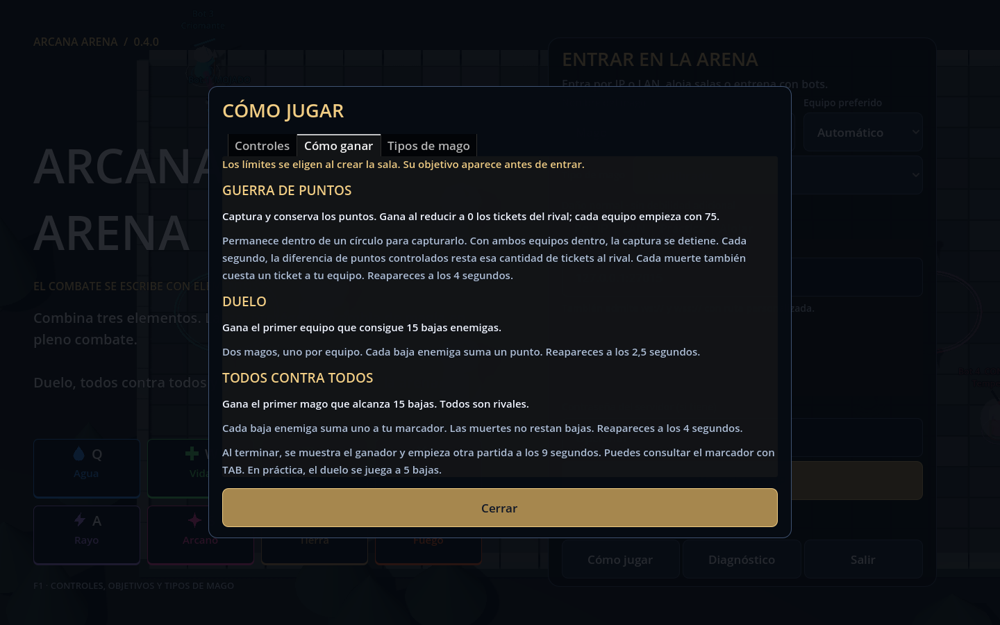

# Cómo ganar

La sala muestra su objetivo antes de entrar. Durante la partida aparece bajo el marcador. **F1 → Cómo ganar** abre la explicación; **TAB** muestra las bajas y muertes.

| Modo | Condición de victoria | Cómo progresar |
|---|---|---|
| Duelo | Primer equipo que alcanza el límite de bajas de la sala. | Hay dos magos, uno por equipo. Cada baja enemiga suma un punto. |
| Todos contra todos | Primer mago que alcanza el límite de bajas. | Todos los demás magos son rivales, aunque compartan el color de la túnica. Cada baja suma uno; morir no resta bajas. |
| Guerra · Arena clásica | Dejar al equipo rival con cero tickets. | Capturar y conservar los tres puntos, y causar bajas enemigas. |
| Guerra · Ciudadela | Controlar los tres puntos sin disputa durante 15 segundos seguidos. | Capturar todos, impedir ataques y defender el control hasta completar el contador. |

## Guerra en Arena clásica

- Cada equipo comienza con los tickets configurados por la sala; por defecto, **75**.
- Entra en el círculo de un punto y permanece dentro para capturarlo. Una captura desde neutral tarda unos **4,2 segundos**; cambiarlo completamente de bando tarda unos **8,3 segundos**.
- Si ambos equipos están dentro, la captura se detiene. Un punto capturado conserva su dueño al salir; el rival debe ocuparlo para neutralizarlo y capturarlo.
- Cada segundo se compara cuántos puntos controla cada equipo. La diferencia resta tickets al equipo que controla menos: con 2 puntos frente a 1, pierde **1 ticket por segundo**; con 3 frente a 0, pierde **3**.
- Cada muerte resta **1 ticket** al equipo del mago muerto, incluidas las muertes propias o por fuego amigo.

## Guerra en Ciudadela de los pasillos

La Ciudadela tiene tres salas conectadas por pasillos y una superficie de suelo **cuatro veces mayor**: 5.632 unidades² frente a 1.408. Se elige en **Práctica → Mapa** o en **Crear sala → Mapa**; todos los jugadores reciben el mismo mapa al conectar.

- La captura conserva sus tiempos habituales. El contador empieza cuando un equipo controla **los tres puntos**.
- Hay que mantener todos los puntos durante **15 segundos consecutivos**, sin enemigos disputándolos. No basta con sumar intervalos separados.
- Si un enemigo entra en un punto controlado, lo disputa o lo neutraliza, el contador vuelve a **0**. Tras recuperar el control total empieza un intervalo nuevo.
- El HUD muestra cuántos puntos tiene cada equipo y el tiempo acumulado sobre **15 s**. Los tickets y las bajas no deciden la victoria.
- Al completar el tiempo gana el equipo que mantiene el control. La partida reinicia a los 9 segundos, con puntos neutrales y contador a cero.
- La cámara sigue al mago; el minimapa dibuja los pasillos y los patios sin suelo. No se pueden atravesar los bordes caminando, con traslación ni con proyectiles.

## Límites, reaparición y nueva partida

El creador elige el límite de bajas y, en Arena clásica, los tickets. Por defecto, duelo y arena se juegan a **15 bajas**; el duelo de práctica se juega a **5**. Reapareces a los **2,5 segundos** en duelo y a los **4** en arena y guerra. Tras anunciar al ganador, comienza otra partida a los **9 segundos**, con los marcadores restablecidos y el mismo tipo de mago.

## Combate

Combina hasta tres elementos. Clic derecho lanza; botón central aplica la magia sobre ti; Mayús + derecho lanza en área. `E` + central activa un escudo; `W` + central cura. El escudo absorbe daño antes que la vida. Elige la afinidad en el launcher: [tipos de mago](TIPOS-DE-MAGO.md).
