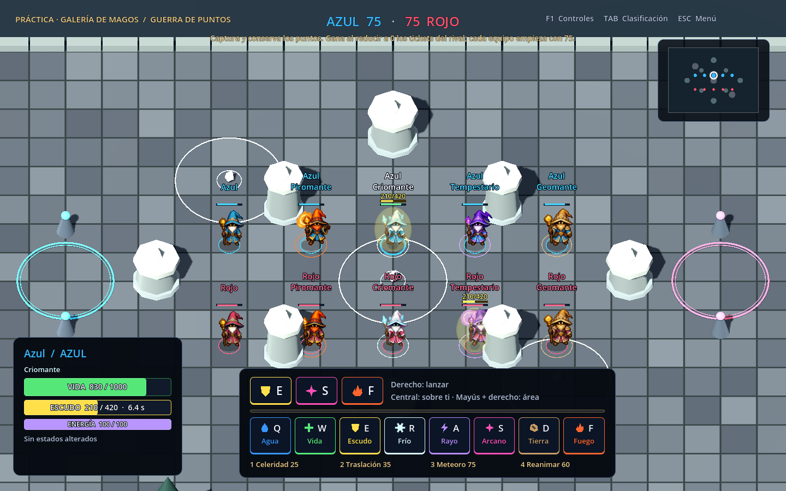

# Sprites de los magos

Primera pasada de arte para los personajes, integrada en la arena de v0.5.0. Los cinco magos sustituyen los cuerpos hechos con cilindros y conos. Tienen túnica, rostro, barba, sombrero, botas, bastón y una pose de lanzamiento propia de la especialidad.

| Tipo | Detalles de especialidad | Archivo en `src/Arcana.Client/Assets/Wizards/` |
|---|---|---|
| Equilibrado | Sombrero flexible, barba blanca, runas y cristal ámbar | `balanced.png` |
| Piromante | Sombrero naranja, barba cobriza, ribetes de llamas | `pyromancer.png` |
| Criomante | Sombrero blanco con cristales, hombros de piel, copos | `cryomancer.png` |
| Tempestario | Sombrero violeta con puntas, capa y runas de rayo | `stormcaller.png` |
| Geomante | Sombrero ocre, hombreras de piedra, runas geométricas | `geomancer.png` |

## Formato y animación

### Giro de 24 orientaciones

El cliente genera **24 vistas por mago**, separadas 15°, con cuatro poses por vista:
96 celdas por personaje y 480 entre los cinco magos. El atlas de combate tiene
1280 × 1920 píxeles, en una cuadrícula de 8 × 12. Las vistas se generan una vez
al cargar al mago o al cambiar su aspecto; girar solo selecciona una celda.

`WizardDirectionalAtlas.cs` parte de las cuatro vistas originales y alinea pies,
rostro y punta del báculo. Interpola el contorno mediante distancias a la silueta,
con color premultiplicado y bordes alfa, para construir las vistas intermedias.
El equipo del Equilibrado se compone **antes** de generar sus orientaciones.
Las piezas conservan familia, posición y agarre; la punta de lanzamiento y los
ojos míticos utilizan los anclajes de la vista generada y del equipo actual.

`WizardFacing.cs` sigue el arco más corto, con velocidad angular independiente de
los FPS y un margen de dos grados contra el ruido en los límites de cada vista.
La marcha sigue el desplazamiento y el lanzamiento sigue el apuntado. La
congelación y el aturdimiento bloquean el giro visual; reaparecer o reutilizar
un enemigo restablece su orientación. El apuntado y el daño del servidor no
cambian.

Inventario y sala de espera conservan el atlas fuente y la resolución original.
Las texturas de combate se comparten entre personajes con el aspecto base;
un aspecto personalizado reutiliza su propia textura al cambiar las piezas.

`--sprites-smoke` comprueba las 24 vistas distintas, las 480 celdas, sus anclajes,
el cruce de 345° a 15°, los estados de control y el giro a 30, 60 y 120 FPS.
`--preview-wizards=turntable` permite capturar una vuelta de los cinco magos.

### Atlas fuente conservados

Cada PNG tiene **1254 × 1254 píxeles**, canal alfa y una cuadrícula de **4 × 4**. Las celdas miden 313,5 píxeles: el código utiliza las divisiones reales del atlas y evita truncar sus coordenadas.

Filas: frente/sur, izquierda/oeste, espalda/norte y derecha/este. Columnas: reposo, paso A, paso B y lanzamiento. Esta primera versión reproduce el movimiento alternando reposo y paso A, con balanceo suave. El paso B queda fuera del ciclo mientras se corrige la continuidad del bastón en esas cuatro celdas. La carga y el lanzamiento continuo usan la cuarta columna; los eventos instantáneos también activan brevemente esa pose. La congelación detiene los pasos. Al morir se oculta el cuerpo y aparece el fantasma; al reaparecer se restaura el sprite.

`atlases.json` guarda los anclajes originales de pies, ojos y lanzamiento. `WizardSprites.cs` conserva estas fuentes, genera los atlas de combate y comparte sus texturas. Los sprites se orientan hacia la cámara y respetan la profundidad del escenario.

Desde v0.12.9, `WizardMotion.cs` interpola posiciones confirmadas y sincroniza la alternancia de pasos y el balanceo con la distancia recorrida. La cámara sigue al sprite visible. El reposo mantiene los pies estables; parada, congelación, reaparición, teletransporte y reanudación de una práctica no conservan el arrastre anterior. `--sprites-smoke` comprueba velocidades y fases a 30, 60 y 120 FPS, con muestras de red a 20 Hz y fluctuación de llegada.

Desde v0.12.16, la marcha usa la dirección de ese desplazamiento interpolado, aunque el ratón o el joystick de apuntado miren hacia otro lado. Durante la carga, la canalización o una pose instantánea se conserva el apuntado. Cuando el lanzamiento termina, la orientación y los pasos vuelven al recorrido. La verificación comprueba las cuatro direcciones, apuntado opuesto, ambos tipos de lanzamiento y parada con los márgenes de interpolación de práctica y red.

## Colores y combate

`team-cloth.gdshader` convierte la tela azul del atlas al color azul o rojo del equipo, conservando luces y sombras. El blanco/cian del hielo, violeta del rayo, naranja del fuego y ocre de la tierra mantienen su especialidad. El anillo del suelo y el nombre refuerzan la identificación del equipo.

Vida, escudo, capacidad restante y nombre se colocan sobre el sombrero y paralelos a la cámara. Las barras no proyectan sombras. El escudo conserva su burbuja, adaptada al tamaño del personaje. Recibir daño en la vida produce un breve destello. Las reglas de daño y los multiplicadores siguen en el servidor; los sprites solo representan su estado.

Las texturas se importan sin pérdida, con alfa y mipmaps. El exportador incluye explícitamente `atlases.json`. No hace falta instalar herramientas de imágenes para compilar o jugar.

## Origen y validación

Arte original generado para este proyecto con la herramienta integrada **`image_gen.imagegen`**, sin utilizar recursos de Magicka. El diseño y los cinco prompts completos están en [wizard-prompts.json](art/wizard-prompts.json). Se conservan las hojas completas; el juego selecciona sus regiones sin modificar los PNG.

`--sprites-smoke` conserva las 120 combinaciones cardinales anteriores y añade las comprobaciones de 24 orientaciones descritas arriba. Incluye color de equipo, cambios de arma, eventos instantáneos, congelación, muerte, reaparición y limpieza. La CI lo ejecuta cuando se solicita compilar, en Linux y en el paquete Windows exportado.
