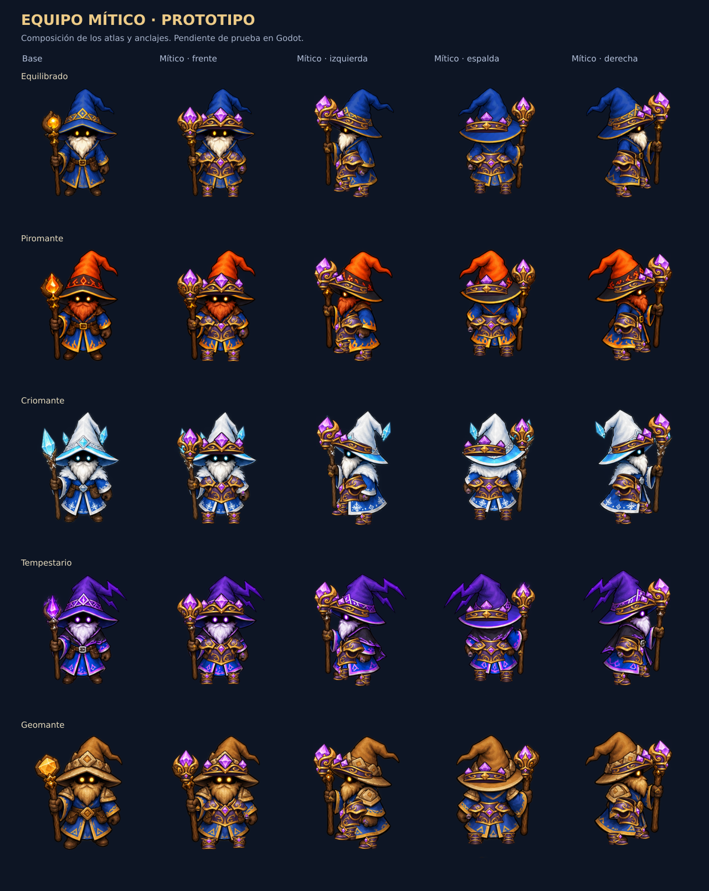

# Prototipo de equipo mítico articulado

Rama: `pruebas/equipo-mitico-articulado`. Un diseño mítico por posición de equipo, con cuatro vistas. Las seis piezas se activan por separado al equipar objetos míticos: corona sobre el gorro, peto, botas, remate del báculo y los dos anillos. Las botas tienen anclajes independientes para cada pie. No se generan imágenes para todas las combinaciones de equipo.



La lámina compone los atlas con sus anclajes y la exclusión de la barba. **No es una captura de Godot**: sirve para revisar el diseño y la colocación antes de compilar. La prueba en movimiento dentro del motor sigue pendiente.

## Integración

- Un atlas RGBA de 1024 × 1536, con 24 vistas: seis piezas por cuatro direcciones. Acero violeta, oro y cristales, siguiendo los contornos y proporciones del arte original.
- `mythic-equipment.json` contiene los recortes de cada pieza y los anclajes de las 16 poses de cada uno de los cinco magos. Se respetan las celdas de 313,5 píxeles del atlas original.
- Se comparten 80 mallas entre combate, inventario y retratos. Cada mago con equipo mítico añade una sola malla y un material, con una máscara que selecciona las piezas equipadas. Cambiar de equipo no genera otra combinación de imágenes ni otra malla.
- La malla de combate comparte el padre y el anclaje de pies con el sprite. Sigue su orientación, marcha, lanzamiento y destello al recibir daño. Se oculta al morir y se reutiliza al reaparecer.
- La barba se conserva delante del peto. Las poses originales sin báculo tampoco muestran el remate. Los enemigos compactos de Supervivencia conservan su representación propia.
- El inventario y los retratos usan la misma geometría en 2D, ajustada al tamaño disponible. Los botones de las seis posiciones conservan su interacción.
- El atlas usa importación sin pérdida, alfa y mipmaps. El índice se incluye explícitamente en Windows y Android. La preparación de magos genera las mallas; la etapa existente de poder mítico durante la carga dibuja el material de combate.

El aspecto depende de la **calidad**, no de estadísticas, afijos o niveles de mejora. Este prototipo utiliza un solo diseño mítico compartido entre familias. Las calidades inferiores mantienen el sprite base. No modifica objetos guardados, ventas, bonificaciones, Firebase ni el protocolo de red. Los halos y ojos míticos existentes conservan sus condiciones de activación.

## Laboratorio desde el menú

Acceso: **Inicio → IA / Defensa → Laboratorio de equipo**. Disponible para ratón y pantalla táctil, sin argumentos de arranque.

- Comparación simultánea de un mago base y otro con las piezas elegidas, usando `WizardVisual`, el mismo renderizador de las partidas.
- Selección de los cinco magos, cuatro orientaciones y color azul/rojo de equipo.
- Calidad independiente de las seis posiciones, incluida la opción Vacío. Acciones Todo mítico y Vaciar equipo.
- Reposo, caminar en el sitio, lanzar, congelación, daño, muerte y reaparición. El modo Automático recorre los estados y las direcciones.
- Pestaña Inventario con el mismo `EquipmentAvatar` y las mismas piezas de la comparación de combate.
- Atrás, Escape y Atrás de Android vuelven al menú. La prueba no escribe el perfil, el equipamiento ni los objetos de la cuenta.

El argumento `--preview-equipment-lab` abre directamente esta pantalla. La galería anterior de diez magos se conserva para capturas y regresiones.

## Recursos y procedencia

| Recurso | Ruta |
|---|---|
| Atlas generado | `src/Arcana.Client/Assets/Wizards/mythic-equipment.png` |
| Recortes y articulaciones | `src/Arcana.Client/Assets/Wizards/mythic-equipment.json` |
| Render compartido | `src/Arcana.Client/Scripts/MythicEquipmentVisuals.cs` |
| Integración en combate | `src/Arcana.Client/Scripts/WizardVisual.MythicEquipment.cs` |
| Integración en inventario y retratos | `src/Arcana.Client/Scripts/EquipmentAvatar.MythicEquipment.cs` |
| Prompt completo y referencia | [mythic-equipment-prompt.json](mythic-equipment-prompt.json) |

El atlas se creó con `image_gen.imagegen`, tomando `balanced.png` como referencia de estilo. Se conserva el PNG generado; los recortes se realizan mediante coordenadas y no modifican la imagen.

## Comprobaciones

Ejecutado sin compilar:

```text
python3 scripts/check-mythic-equipment.py
MYTHIC_ASSETS_OK: 24 vistas, 80 poses, 540 anclajes, alfa, recortes, importación y Windows/Android.
```

El comprobador requiere Pillow y revisa decodificación, transparencia, arte dentro de sus regiones, coordenadas finitas, límites de cada pose, exclusión de barba, coherencia del báculo, importación y filtros de exportación. Se revisó visualmente la composición en reposo y lanzamiento. Las compilaciones normales siguen siendo manuales; la publicación solicitada expresamente usa el disparador limitado descrito abajo.

La publicación exige compilar C#, cargar y validar los shaders en Godot, ejecutar las comprobaciones del motor y exportar Android/Windows. Los resultados de cada ejecución y sus capturas quedan registrados en GitHub Actions.

`--sprites-smoke` incluye una regresión para los cinco magos, seis posiciones, todas las calidades, equipar/desequipar, orientación, lanzamiento, congelación, muerte, reaparición, inventario y retratos.

`--equipment-lab-smoke` verifica el acceso desde el menú, el cambio de piezas y calidad, las cuatro direcciones, las animaciones, el inventario, Atrás y la conservación del perfil. La CI lo ejecuta con viewport real de escritorio y móvil y conserva las capturas.

La publicación solicitada usa el flujo manual de CI con `publish_preview=true` y `publish_stable=false`. El tag final tiene el formato `preview-v0.29.37-rN`, donde `N` es el número real de compilación. Solo se publica si pasan las comprobaciones y los paquetes Android/Windows. El flujo de solicitud está limitado a esta rama, al archivo de solicitud y al mensaje exacto `Publicar prueba de equipo mítico 0.29.37`; una subida normal de código no lo activa.

Después de la compilación solicitada expresamente, la galería permite comparar la fila base y la mítica con estos argumentos del ejecutable:

```text
--preview-wizards=mythic-front
--preview-wizards=mythic-west
--preview-wizards=mythic-back
--preview-wizards=mythic-east
--preview-wizards=mythic-motion
```

La galería es una escena de verificación local; no modifica el inventario ni concede objetos a la cuenta.
